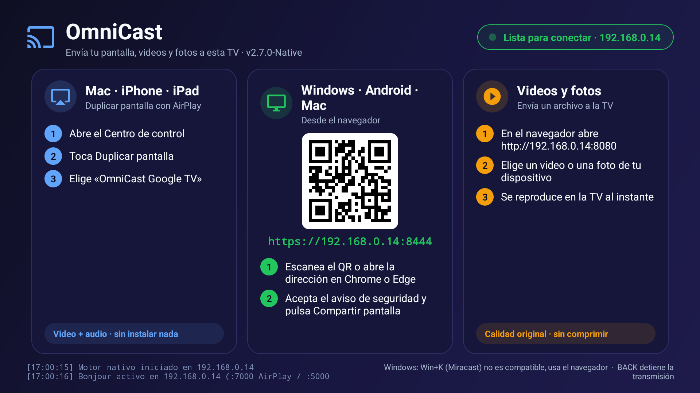

# OmniCast TV

Receptor inalámbrico para **Google TV / Android TV**. Instala la app en la TV y envía a la pantalla desde tu Mac, iPhone, iPad, Windows o Android, sin instalar nada en el emisor y sin pagar nada. Todo funciona dentro de tu red Wi-Fi.



La pantalla de inicio de la TV muestra, paso a paso, cómo conectar cada tipo de dispositivo. Incluye un **código QR** que abre el emisor web desde el teléfono.

## Índice

1. [Qué es y qué hace](#qué-es-y-qué-hace)
2. [Cómo conectarte (uso)](#cómo-conectarte-uso)
3. [Qué funciona](#qué-funciona)
4. [Instalación en la TV](#instalación-en-la-tv)
5. [Configuración](#configuración)
6. [Cómo funciona por dentro](#cómo-funciona-por-dentro)
7. [Calidad de audio y video](#calidad-de-audio-y-video)
8. [Diagnóstico y solución de problemas](#diagnóstico-y-solución-de-problemas)
9. [Compilación](#compilación)
10. [Puertos](#puertos)
11. [Estructura del código](#estructura-del-código)

---

## Qué es y qué hace

OmniCast TV convierte una TV con Android en un receptor de pantalla compatible con varios protocolos a la vez:

- **AirPlay (duplicar pantalla):** la TV aparece en el menú *Duplicar pantalla* de macOS, iOS y iPadOS. Recibe video H.264 y audio AAC cifrados con FairPlay.
- **Emisor web:** desde Chrome o Edge se comparte pantalla y audio a la TV, sin instalar nada.
- **Envío de archivos:** se manda un video o una foto desde el navegador y se reproduce en la TV.
- **DLNA / UPnP:** la TV se anuncia como renderizador multimedia (experimental).
- **Xbox Cloud Gaming:** acceso directo a `xbox.com/play` dentro de la app (experimental).

Novedades recientes:

- **La TV se anuncia con su propio nombre.** En el menú de duplicar ya no aparece el nombre de la app, sino el nombre que la TV tiene en *Ajustes → Acerca de → Nombre del dispositivo*. Ver [Configuración](#nombre-de-la-tv-en-el-menú-de-duplicar).
- **Audio más estable.** Colchón anti-jitter, buffer más grande, descarte de paquetes RTP duplicados o tardíos y hilo de audio con prioridad alta. Ver [Calidad de audio y video](#calidad-de-audio-y-video).
- **Ajuste de sincronía audio/video** calibrable sin recompilar.
- **Estadísticas en el log** del audio y del video para diagnosticar problemas.
- Descubrimiento AirPlay con `NsdManager` (nativo de Android) en lugar de JmDNS, y corrección de FairPlay para Android 11.

---

## Cómo conectarte (uso)

### Mac, iPhone y iPad: AirPlay
1. Abre el **Centro de control**.
2. Toca **Duplicar pantalla**.
3. Elige tu TV por su nombre (por ejemplo **«Android TV»**, o el nombre que le hayas puesto en sus ajustes).

Se envía video y audio. La TV y el dispositivo deben estar en la misma red Wi-Fi.

En la Mac, si la duplicación se queda en modo *Extender*, cambia a *Duplicar* desde **Ajustes del Sistema → Pantallas** o desde el icono de pantallas en la barra de menú.

### Windows, Android y Mac: desde el navegador
1. En la TV aparece una dirección como `https://192.168.0.14:8444` y su QR. Escanéalo o escribe la dirección en **Chrome o Edge**.
2. El navegador avisa que el certificado no es de confianza (es autofirmado): acepta y continúa.
3. Pulsa **Compartir pantalla** y elige la pantalla o ventana. Marca *compartir audio* para enviar también el sonido.

### Enviar un video o una foto
1. Abre `http://<IP-DE-LA-TV>:8080` en el navegador.
2. Elige un archivo de tu dispositivo.
3. Se reproduce en la TV con su calidad original.

### Xbox Cloud Gaming (experimental)
En la pantalla de inicio, el botón verde **Xbox Cloud Gaming** abre `xbox.com/play` dentro de la app, con el WebView del sistema y el perfil de navegador que usa Better xCloud en Android TV. Empareja un mando Bluetooth en *Ajustes → Mandos y accesorios*, inicia sesión con tu cuenta de Microsoft y necesitas Xbox Game Pass. Con el botón BACK vuelves a OmniCast. No es una función oficial de Microsoft y puede dejar de funcionar si cambian la web.

> **Windows y Miracast.** La proyección nativa de Windows (**Win+K** / *Conectar a pantalla inalámbrica*) **no es compatible**. Miracast exige que el receptor use Wi-Fi Direct, y no todas las TV con Android lo tienen (por ejemplo, el Chromecast HD no). Android tampoco permite que una app actúe como receptor Miracast. En Windows usa el navegador, como se explica arriba.

---

## Qué funciona

| Origen | Método | Pantalla | Audio | Video / foto |
|---|---|:---:|:---:|:---:|
| Mac, iPhone, iPad | AirPlay | ✅ | ✅ | foto ✅ · video por URL (experimental) |
| Windows, Android, Mac | Navegador (`:8444`) | ✅ | ✅ | ✅ (subida a `:8080`) |
| Windows | Miracast / Win+K | ❌ no compatible | | |
| VLC, apps DLNA | DLNA/UPnP | | | experimental |

Requisitos del navegador para compartir pantalla: **Chrome o Edge** reciente (necesita WebCodecs). Safari y Firefox no están soportados para el emisor web.

**Audio de AirPlay:** se decodifica AAC-ELD (el que usa la duplicación de pantalla) y AAC-LC. ALAC (música sin pérdida, solo audio) no tiene decodificador en Android y no está soportado.

---

## Instalación en la TV

1. Descarga **`OmniCastTV.apk`** desde la [última Release](../../releases/latest).
2. En la TV activa las **Opciones de desarrollador** (*Configuración → Sistema → Acerca de*, pulsa 7 veces sobre *Compilación*) y la **depuración por ADB / inalámbrica**. Otra opción es instalar el APK con la app **Downloader**.
3. Con ADB desde tu computadora, en la misma red:
   ```bash
   adb connect <IP-DE-LA-TV>:5555
   adb install -r OmniCastTV.apk
   ```
4. Abre **OmniCast Native TV** desde el menú de aplicaciones. Aparece con su banner en la pantalla principal de Google TV.

Todas las versiones se firman con la misma clave, así que cada una se instala encima de la anterior sin desinstalar.

**Requisitos:** Android 7.0 o superior (`minSdk 24`), TV conectada a la misma red que el emisor, y red sin aislamiento de clientes.

---

## Configuración

OmniCast no necesita configuración para funcionar. Estos son los ajustes opcionales.

### Nombre de la TV en el menú de duplicar

La app anuncia la TV con el nombre del dispositivo de Android (`Settings.Global.device_name`). Si está vacío, usa el modelo de la TV. Para cambiarlo:

1. En la TV: **Configuración → Sistema → Acerca de → Nombre del dispositivo**.
2. Cierra y vuelve a abrir OmniCast TV.

El mismo nombre se usa en AirPlay (`_airplay._tcp` y `_raop._tcp`), en DLNA y en la guía de la pantalla de inicio. La Mac puede tardar unos segundos en actualizar la lista por caché de Bonjour.

### Sincronía de audio y video

La sincronía es **automática**. La Mac marca cada cuadro de video con su hora (NTP) y manda paquetes que ligan el audio a esa misma hora. La app compara cuándo llega cada uno, suma la latencia real de salida del audio (colchón + mezclador de Android + HDMI, medida con `AudioTrack.getTimestamp`) y la del decodificador de video, y retrasa el video lo justo. El retraso se ajusta poco a poco (3 ms por cuadro) para que no haya saltos. Mientras no haya audio, se usa un retraso de 50 ms.

Si aun así notas un desfase constante en tu TV, puedes sumar o restar milisegundos a lo medido, sin recompilar (se relee cada segundo):

```bash
adb shell "mkdir -p /sdcard/Android/data/com.omnicast.tv/files"
adb shell "echo 40 > /sdcard/Android/data/com.omnicast.tv/files/av_delay_ms"
```

- Si el **audio llega tarde** respecto a la imagen, usa un número **positivo** (retrasa más el video).
- Si el **audio se oye antes** que la imagen, usa un número **negativo**, por ejemplo `-40`.
- Rango permitido: -300 a 600 ms.
- Para quitar el ajuste, borra el archivo: `adb shell rm /sdcard/Android/data/com.omnicast.tv/files/av_delay_ms`.

### Constantes en el código

| Constante | Archivo | Valor | Para qué |
|---|---|---|---|
| `PREROLL_MS` | `LowLatencyAudioPlayer.kt` | 50 | Audio acumulado antes de empezar a sonar. Súbelo si hay cortes en Wi-Fi malo; bájalo para menos retardo. |
| Buffer del `AudioTrack` | `LowLatencyAudioPlayer.kt` | mínimo × 4 | **No reducirlo**: con 300 ms Android lo asignó a la salida «deep buffer» (`Flags 0x008` en `dumpsys media.audio_flinger`), que en una TV de prueba nunca consumía y dejaba el audio mudo. La latencia la acota el recorte de cola, no el tamaño del buffer. |
| `STALL_MS` | `LowLatencyAudioPlayer.kt` | 1000 | Si la pista no avanza durante este tiempo con audio en cola, se reconstruye. |
| `HIGH_MS` / `LOW_MS` | `LowLatencyAudioPlayer.kt` | 200 / 60 | Cola de audio que dispara el recorte y hasta dónde se recorta. |
| `MIN_JITTER_MS` | `HardwareH264Decoder.kt` | 60 | Colchón mínimo de video contra el jitter del Wi-Fi. |
| `DEFAULT_VIDEO_DELAY_MS` | `HardwareH264Decoder.kt` | 50 | Retardo de video mientras `AvSync` aún no tiene datos de audio. |
| `MAX_DELAY_MS` / `SLEW_MS` | `HardwareH264Decoder.kt` | 800 / 3 | Tope del retardo y ritmo con que se acerca al objetivo. |
| Resolución y fps anunciados | `AirPlayBonjourService.kt` | 1920×1080 a 60 | Lo que la Mac cree que soporta la TV. |

---

## Cómo funciona por dentro

```
Mac / iPhone ──AirPlay──►  Bonjour (NsdManager) anuncia  _airplay._tcp :7000  y  _raop._tcp :5000
                           │
                           ▼
                    RTSP: pair-verify (Ed25519) → fp-setup (FairPlay) → SETUP
                           │
          ┌────────────────┴─────────────────┐
          ▼                                  ▼
  Video: TCP :7100                    Audio: UDP :7103 (RTP)
  AES-CTR → NAL H.264                 AES-CBC → AAC-ELD
          │                                  │
  Línea de retardo (av_delay_ms)      Descarta duplicados/tardíos (nº de secuencia)
          │                                  │
  MediaCodec H.264 (hardware)         MediaCodec AAC → PCM
          │                                  │
      SurfaceView                  AudioTrack con colchón anti-jitter
```

1. **Descubrimiento.** `AirPlayBonjourService` registra los servicios Bonjour con `NsdManager`. Los registros llevan la clave pública Ed25519, las capacidades y el nombre de la TV.
2. **Emparejamiento y cifrado.** La Mac abre una conexión RTSP, hace `pair-verify` y negocia FairPlay. De ahí salen las claves AES para el video (CTR) y el audio (CBC).
3. **Video.** Los cuadros H.264 llegan por TCP al puerto 7100, se descifran y se convierten de formato AVCC a Annex-B. Pasan por una cola con una pequeña línea de retardo y entran al decodificador de hardware, que dibuja directo sobre la `SurfaceView`.
4. **Audio.** Llega por UDP en paquetes RTP de unos 10 ms. Se descifra, se descartan los paquetes duplicados o fuera de orden, se decodifica AAC-ELD a PCM y se reproduce con `AudioTrack`.
5. **Reloj.** El puerto 7102 responde a las peticiones de sincronización NTP de la Mac.

El **emisor web** (`sender.html`) captura la pantalla con `getDisplayMedia`, codifica H.264 con WebCodecs y manda video y audio PCM por WebSocket a `NativeStreamServer`, que los pasa a los mismos decodificadores.

---

## Calidad de audio y video

Esta app corre en TV con poca potencia (por ejemplo, un MediaTek MT5867 con menos de 1 GB de RAM). Por eso estas decisiones:

**Audio**
- `AudioTrack` con el buffer del sistema (mínimo × 4) y modo de rendimiento estándar. Con el buffer mínimo y el modo de baja latencia, el audio de AirPlay (44,1 kHz) no obtiene la pista rápida del mezclador de la TV (48 kHz) y cualquier ráfaga de Wi-Fi producía chasquidos.
- **Cola acotada:** la Mac manda una ráfaga de audio al empezar. Como el audio entra al mismo ritmo que sale, esa cola no se vaciaba nunca y el audio iba hasta 700 ms atrasado. Si la cola pasa de `HIGH_MS` (200 ms), se descarta lo que llega hasta bajar a `LOW_MS` (60 ms). Se nota como un corte breve, una sola vez.
- **Colchón anti-jitter:** el audio empieza a sonar con `PREROLL_MS` acumulados. Si el buffer se vacía, se pausa y vuelve a llenar, en lugar de seguir a trompicones.
- **Paquetes RTP:** AAC-ELD es un códec con estado, así que un paquete duplicado o tardío corrompe lo que sigue. Se descartan por número de secuencia.
- **`WifiLock` en modo de baja latencia** mientras la app está abierta. Sin él, el Wi-Fi de la TV entra en ahorro de energía y el tráfico llega a ráfagas (en una TV de prueba, el ping en reposo variaba entre 4 y 69 ms), lo que se oye como microcortes.
- **Hilo de audio con prioridad `URGENT_AUDIO`** y buffer de socket UDP de 256 KB, para que el decodificador de video no le quite CPU.

**Video**
- Decodificación por hardware directa a la superficie, con cada cuadro mostrado en cuanto sale del decodificador.
- **Cada cuadro se programa por su hora de captura** (que la Mac incluye en el paquete) más el tránsito mínimo medido y el retardo de sincronía, en vez de mostrarse al llegar. El jitter del Wi-Fi no llega a la pantalla y se evitan los saltos. Un cuadro que llega tarde sale de inmediato. Hay un colchón mínimo de `MIN_JITTER_MS` (60 ms).
- **El retardo de sincronía se aplica antes de decodificar**, sobre datos comprimidos, que cuestan casi nada. Retener cuadros ya decodificados agota los pocos buffers de salida de algunos decodificadores OMX (como `OMX.MS.AVC.Decoder`) y la imagen se arrastra.
- Los cuadros se descartan con cuidado: nunca el SPS/PPS ni los cuadros clave (IDR).
- `KEY_MAX_INPUT_SIZE` de 2 MB por buffer de entrada, para no gastar memoria en TV con poca RAM.

---

## Diagnóstico y solución de problemas

### Ver los logs

```bash
adb connect <IP-DE-LA-TV>:5555
adb logcat -s AirPlayService LowLatencyAudio HardwareH264Decoder
```

La pantalla de inicio de la TV también muestra los últimos eventos al pie.

**Estadísticas que se escriben cada 5 segundos mientras duplicas:**

| Log | Campo | Qué significa |
|---|---|---|
| `LowLatencyAudio` | `rearms` | Veces que el audio se quedó sin datos y tuvo que volver a llenar el colchón. Debería ser 0 o muy bajo. |
| | `drops` | Escrituras que no cupieron en el buffer (audio llegando más rápido de lo que suena). |
| | `underrunsTrack` | Vaciados del buffer del `AudioTrack` reportados por Android. |
| `HardwareH264Decoder` | `in` / `out` | Cuadros enviados al decodificador y cuadros mostrados en 5 s. Si `out` es mucho menor que `in`, el decodificador no da abasto. |
| | `dropped` | Cuadros descartados porque la cola estaba llena. |
| | `queue` | Cuadros esperando. Si crece sin parar, la TV no puede con el flujo. |
| | `kbps` | Tasa de video que manda la Mac. En Wi-Fi de 2,4 GHz, valores altos y sostenidos saturan el enlace. |
| | `applied` | Retraso de video que se está aplicando ahora. |
| | `vMin` / `aMin` | Tránsito mínimo medido de video y de audio (ms, incluye la diferencia de relojes con la Mac). |
| | `audioOut` / `dec` | Latencia de salida del audio y del decodificador de video. |
| | `target` | Retraso de video calculado. `-` significa que aún faltan datos (por ejemplo, no ha empezado el audio). |

### Problemas comunes

- **La TV no aparece en AirPlay:** comprueba que ambos estén en la misma red y que el router no tenga *aislamiento de clientes* (AP isolation) ni bloquee mDNS/multicast. Desde la Mac puedes comprobarlo con `dns-sd -B _airplay._tcp local.`
- **Aparece con otro nombre:** el nombre sale de *Ajustes → Acerca de → Nombre del dispositivo* de la TV. Ver [Configuración](#nombre-de-la-tv-en-el-menú-de-duplicar).
- **El audio suena con cortes o chasquidos:** mira `rearms` y `underrunsTrack` en el log. Si suben, sube `PREROLL_MS`, acerca la TV al router y, si la TV lo permite, conéctala por **cable Ethernet** o a la banda de **5 GHz**. Muchas TV solo tienen Wi-Fi n de 2,4 GHz, que se satura con 1080p a 60 fps.
- **El audio no va sincronizado con la imagen:** calibra `av_delay_ms`. Ver [Sincronía de audio y video](#sincronía-de-audio-y-video).
- **La imagen se ve lenta o entrecortada:** mira `in`, `out` y `queue` de `HardwareH264Decoder`. Si `out` es mucho menor que `in`, el decodificador de la TV no da abasto con 1080p a 60 fps. Prueba con `av_delay_ms` en `0` para descartar el retardo.
- **En la Mac se queda en modo *Extender* y no deja pasar a *Duplicar*:** cambia el modo en *Ajustes del Sistema → Pantallas*, o desconecta y vuelve a conectar la duplicación.
- **El navegador no abre `:8444`:** acepta el aviso del certificado. Sin HTTPS el navegador no deja compartir pantalla.
- **Se ve la imagen pero no se oye:** en el navegador marca *compartir audio* al elegir la pantalla; en AirPlay revisa que el volumen de la TV no esté en silencio.

---

## Compilación

- **GitHub Actions (recomendado):** cada `push` a `master` ejecuta `.github/workflows/build-apk.yml`, compila con Gradle 8.4 / JDK 17 y publica una Release con `OmniCastTV.apk` (release) y `OmniCastTV-debug.apk`.
- **Android Studio:** abre esta carpeta y ejecuta **Build → Build APK(s)**.

El repositorio no incluye `gradlew`, así que en local necesitas Android Studio o Gradle 8.4 instalado.

La tarea `injectFairPlayEngine` descarga en `preBuild` el motor FairPlay de [`serezhka/java-airplay-lib`](https://github.com/serezhka/java-airplay-lib), así que la primera compilación necesita internet.

---

## Puertos

| Puerto | Protocolo | Uso |
|---|---|---|
| 7000, 5000 | TCP | AirPlay / RAOP (RTSP, emparejamiento, FairPlay) |
| 7100 | TCP | Video de duplicación H.264 |
| 7101 | TCP | Eventos AirPlay |
| 7102 | UDP | Sincronización de reloj (NTP) |
| 7103, 7104 | UDP | Audio AirPlay (RTP) y control |
| 8080 | TCP | Emisor web (HTTP), subida de archivos, DLNA |
| 8444 | TCP | Emisor web (HTTPS) con duplicación de pantalla |
| 1900 | UDP | Descubrimiento DLNA (SSDP) |
| 5353 | UDP | Bonjour / mDNS (AirPlay) |

## Estructura del código

| Archivo | Función |
|---|---|
| `MainActivity.kt` | Pantalla de inicio, reproductor, nombre de la TV y arranque de los servicios |
| `AirPlayBonjourService.kt` | AirPlay: anuncio mDNS, RTSP, emparejamiento, FairPlay, video y audio |
| `AirPlayAudioDecoder.kt` | Decodifica el audio AAC (ELD/LC) de AirPlay y descarta paquetes fuera de orden |
| `HardwareH264Decoder.kt` | Decodificador H.264 por hardware (MediaCodec), línea de retardo A/V y estadísticas |
| `AvSync.kt` | Calcula el retardo de video a partir de las marcas de tiempo de video y audio |
| `LowLatencyAudioPlayer.kt` | Reproducción de audio PCM con colchón anti-jitter |
| `NativeStreamServer.kt` | Servidor HTTP/HTTPS + WebSocket del emisor web y subida de archivos |
| `DlnaSsdpService.kt` | Descubrimiento DLNA/UPnP |
| `XboxCloudActivity.kt` | Acceso a Xbox Cloud Gaming en un WebView |
| `assets/sender.html` | Página del emisor web (captura, codificación H.264 y envío) |
